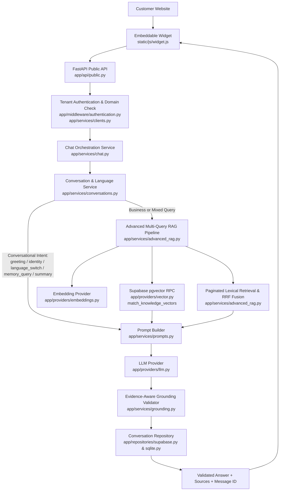
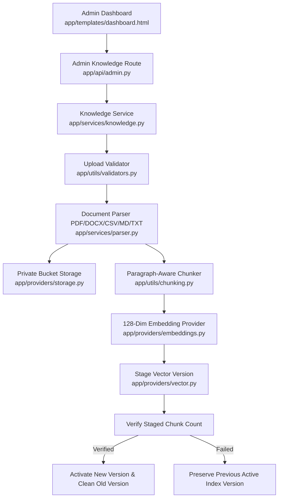
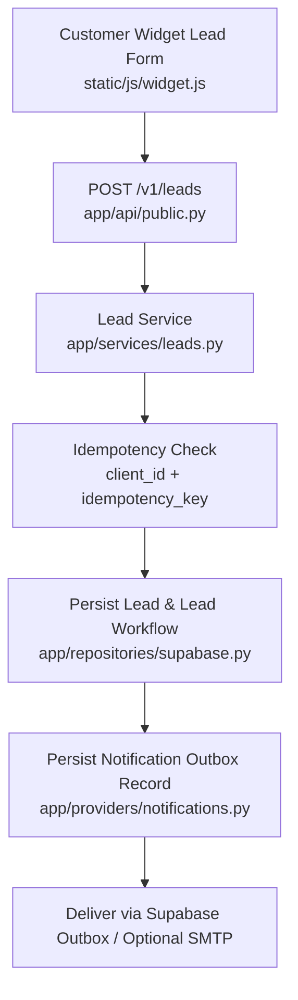

# Orbit AI — Architecture & Data Flow

Orbit AI is a centralized, multi-tenant AI customer-support SaaS platform built with Python, FastAPI, Supabase PostgreSQL, pgvector (`vector(128)`), and a vanilla JavaScript embeddable customer widget.

## 1. Customer Chat, Orchestration & Grounded RAG Flow

## 2. Safe Versioned Knowledge Ingestion Flow

## 3. Idempotent Lead Capture & Outbox Notification Flow

